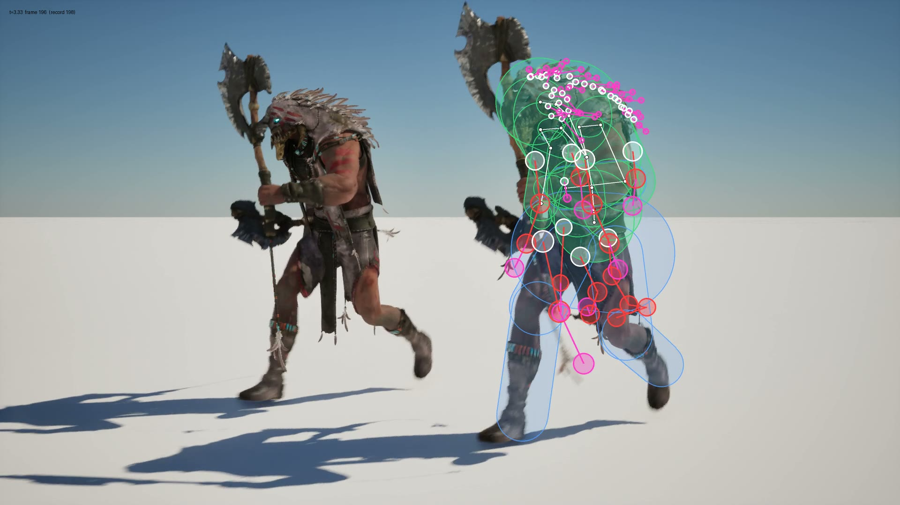

<div align="center">

# MotionTerminal

**One animation system for many rigs, built by an agent over MCP and checked by tests that can fail.**

[](LICENSE)
[](https://www.unrealengine.com/)
[](https://www.python.org/)
[](https://github.com/sushiHex/motion-terminal/actions/workflows/host-tests.yml)

[Problem](#the-problem) · [What I built](#what-i-built) · [Results](#results) · [Lessons](#three-lessons) · [Verification](#verification) · [Quickstart](#quickstart) · [Technical guide](docs/guide.md)

</div>

> [!NOTE]
> **Every asset here is authored through tool calls.** That covers the AnimGraphs, IK rigs, retargeters, Control
> Rigs and physics assets. A coding agent drives Unreal's own MCP server, and this project's C++ plugin adds the
> tools the engine lacks. No builder vouches for its own work: a separate read, sharing no code with the builder,
> must match the spec before an asset is saved.

[](docs/media/khaimera-dynamics-controls.mp4)

<sub>Khaimera's secondary motion, with its colliders and simulated chains drawn over the second take. Click for the clip.</sub>

## The problem

A studio has one locomotion system and a roster of characters with different skeletons and proportions. Each
character joins through retargeting, foot IK, physics and secondary motion. Each of those steps can break
**silently**:
- a bake that comes out frozen;
- a binding that comes loose;
- a scale off by 100x after an FBX import;
- a hair trail that halves after an engine upgrade.

The editor shows nothing wrong until someone watches the right shot. Tests help only if they can actually fail:
a check that passes on a broken rig is worse than none.

## What I built

| Part | What it does |
|:--|:--|
| **One AnimBP Template** | Locomotion state machine, upper-body layered montages, aim offset and off-hand IK. Characters override clips and data, never structure. Ten named variables are the whole gameplay contract. |
| **Hero onboarding** | `mt.py onboard <Hero>`: IK rig, retargeter, bake, locomotion, in-place clips, pawn, physics, verify. Each stage leaves a record, so a failed run names the stage and `--resume` continues from it. |
| **Secondary motion** | Control Rig dynamics for hair, cloth and straps, with colliders auto-fitted to the mesh. A per-hero ON/OFF drive is gated on trail, swing, clearance and stability against a stored baseline. |
| **Verification layer** | A golden-diff of every rig's graph, PIE runtime assertions, live per-node blend weights over MCP, import-scale integrity, and a check that every baked clip actually moves. |
| **Mocap intake** | CMU ASF/AMC is read into a canonical skeleton. Each vendor delivery is frozen under a licence gate, and each take is evaluated on labelled foot contacts. When one is rejected, a brief goes back to the vendor, naming the source frames and who owns each fault. |

The plugin adds six toolsets: AnimGraph read, diff, build and describe; skeleton and blend-space tools; live
AnimInstance introspection; stat sampling; and FBX import-scale tools. See the [technical guide](docs/guide.md#plugin-tools).

## Results

| Measured | Result |
|:--|:--|
| **Roster** | One Template drives a MetaHuman body (158 cm), Manny and Quinn (180 cm) and Paragon Khaimera (210 cm, 198 bones, via the IK Retargeter). Aurora and Grux pass all onboarding stages on UE 5.9. |
| **Crowd budget** | 46 instances on one Template across three LOD/URO tiers. Game-thread anim time is 3.6 ms average against a 4.0 ms gate; memory is 4.64 MB per instance against a 6.0 MB gate. |
| **Off-hand IK** | Hand to rifle foregrip: 10.43 cm with IK off, 1.34 cm with it on, measured in the render (`Plugins/MotionTerminal/Tests/render_evidence.json`). |
| **UE 5.8 to 5.9 upgrade** | Aurora's hair trail dropped by up to 42% on 5.9. After the fix, the gate passes 67 of 67 checks, and every value equals the 5.8 baseline. |

## Three lessons

### 1. The engine upgrade that changed what "air" means

On 5.9, Aurora's hair trailed up to 42% less. Nothing in the rig had changed.
- **The cause:** the engine source diff showed that 5.9 treats the external velocity on Control Rig dynamics as
  motion of the simulation space, and scales it by the drag multiplier. 5.8 added it directly. The rig set that
  multiplier to 0, so the authored air was multiplied away.
- **The fix:** a mapping in the rig builder (`Scripts/dynamics_rig.py`) that reproduces 5.8's equation on 5.9,
  by setting the new 5.9 drag and space-motion options explicitly and negating the authored air.
- **The proof:** the gated drive reads back equal to the 5.8 baseline on every check. **The gate caught a
  regression that the editor showed as working hair.**

### 2. The foot that was a socket

Every foot measurement on the Paragon rigs read 13.3 cm off. Unreal's Python bone reads prefer a socket with the
same name, ignoring case, and the Paragon meshes put a `Foot_L` / `Foot_R` socket 13.3 cm down each foot. So the
foot-IK numbers were measuring a point on the shoe. All bone reads now go through one helper,
`mt_drive.bone_transform`. It undoes a socket on the bone itself and refuses a same-named socket on another bone.

### 3. Pawns that never ran their rig

In the dynamics drive, the post-process rig on off-camera pawns never evaluated. Unreal skips the animation
update for a mesh it hasn't recently rendered, so the rig's witness curves were absent until the pawns ran into
view at frame 311. Then the pose snapped 15 cm. Hardware ray tracing had hidden this, because its scene marks
every mesh as rendered. Every drive now sets `ALWAYS_TICK_POSE_AND_REFRESH_BONES`. The gate's structural checks
include `responds`: each part's tip must move from the OFF pose, or the run fails.

## Verification

**A test that cannot fail is not a test.** Every gate added or reworked for the roster, import-integrity and
skeleton-aware work has a **proven-OFF**: a recorded run where it goes red for the right reason. They are
catalogued with the runs that produced them in [docs/verification-design.md](docs/verification-design.md).

```
$ python Scripts/run_verification.py              # topology + golden-diff  -> Tests: 29  Failed: 0
$ python Scripts/run_verification.py --tier pie   # PIE runtime assertions  -> Tests: 24  Failed: 0
$ python -m pytest Scripts/ -q                    # host-side tooling       -> 940 passed, 5 skipped
```

On a clean clone, **13 of the 29** default-tier rows and **9 of the 24** pie rows skip with a log line, because
they need separately licensed content. Every run prints how many rows it actually exercised, so a green line is
never mistaken for full coverage. The [technical guide](docs/guide.md#what-skips-on-a-clean-clone) lists what turns
each row on. CI runs the host suite and the public-content gate on every push.

## Quickstart

Windows, UE 5.9, Visual Studio 2022 and Python 3.14. The host suite needs no engine.

```powershell
git clone https://github.com/sushiHex/motion-terminal.git MotionTerminal
cd MotionTerminal
python -m pip install -r Scripts/requirements-dev.txt
python -m pytest Scripts/ -q                       # host suite, no engine

python Scripts/mt.py editor start                  # editor + its MCP server
python Scripts/mt.py onboard <Hero>                # bring a character onto the Template
python Scripts/mt.py run <Hero> <tag> --gate       # dynamics ON/OFF drive, judged against its baseline
```

The editor tiers also need Epic's Third Person template content copied in. The [technical guide](docs/guide.md)
covers the build, the content, every operation and what a clone can't reproduce.

---

<sub>[MIT](LICENSE) for this project's code, docs and authored assets. Unreal Engine content, Paragon and MetaHuman
assets, and CMU motion data keep their own terms; two committed assets carry Epic-derived data. See
[NOTICE](NOTICE) and the [licence detail](docs/guide.md#licence-detail).</sub>
